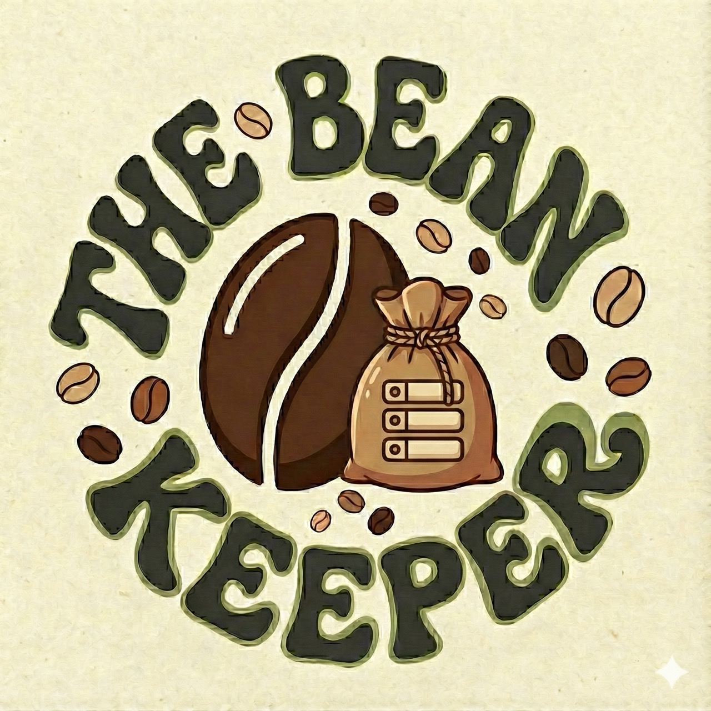
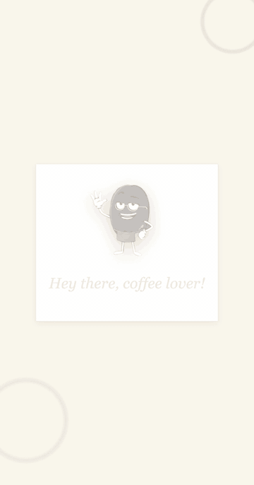

# The Bean Keeper

[](https://www.typescriptlang.org/)
[](https://react.dev/)
[](https://expressjs.com/)
[](./LICENSE)

A mobile-first coffee tracking application that integrates multiple AI providers (Groq/Llama, Google Gemini, Tesseract OCR) to automatically extract, structure, and enrich coffee data from bag label photos.



**Live:** [the-bean-keeper.onrender.com](https://the-bean-keeper.onrender.com)

## Demo Video

<a href="docs/bean-keeper-demo.mp4">
  
</a>

Watch or download the full **[The Bean Keeper demo video](docs/bean-keeper-demo.mp4)**.

## Why This Project

This started as a personal tool and became a proving ground for multi-provider AI integration. Each AI provider was selected for what it does best:

- **Groq (Llama 3.1 8B)** for structured data extraction: fast inference, JSON mode, low cost per call. Chosen over GPT/Claude for this task because extraction needs speed, not reasoning depth.
- **Google Gemini Pro** for video generation pipeline: multimodal capabilities for converting screen recordings into polished product demos.
- **Tesseract.js** for client-side OCR: runs in the browser, zero API cost, handles multilingual text (English + Chinese).
- **ElevenLabs** for voice synthesis in the video pipeline.

If AI extraction fails, regex-based extraction catches common patterns. The app can use local photo storage during development; production uploads need persistent storage.

## Features

- **AI-Powered Extraction**: Upload coffee bag photos. AI extracts roaster, origin, variety, process method, roast level, and more.
- **Bilingual Interface**: Full English and Traditional Chinese support with auto-detection
- **Supabase Auth with Notion**: Users sign in through Notion and get their own coffee database
- **Guest Mode**: Browse the owner's collection without logging in (read-only)
- **Advanced Filtering**: Filter by roast level, rating, origin with dynamic sort
- **AI Video Pipeline**: Converts screen recordings into product demos (Remotion + Gemini + ElevenLabs) at $0 cost
- **Mobile-First**: Dual photo upload (camera + file picker), responsive 2-5 column grid

## Tech Stack

### AI / ML Pipeline
| Layer | Provider | Why This Provider |
|-------|----------|-------------------|
| OCR | Tesseract.js (client-side) | Zero API cost, browser-native, multilingual |
| Data extraction | Groq AI (Llama 3.1 8B) | Fast inference, JSON mode, structured output |
| Video generation | Gemini Pro (Google) | Multimodal, long context for video scripts |
| Voice synthesis | ElevenLabs | Natural speech for product demos |
| Fallback | Regex patterns | Graceful degradation when AI fails |

### Application
- **Frontend**: React 18, TypeScript, Vite, TanStack Query, shadcn/ui, Tailwind CSS
- **Backend**: Express.js, TypeScript, Notion SDK, Cloudinary
- **Auth**: Supabase Auth with Notion provider and Bearer token verification
- **Deployment**: Render.com with Cloudinary for persistent photo storage

## 📦 Quick Start

### Prerequisites
- Node.js 18+
- Groq API key ([groq.com](https://groq.com))
- Supabase project ([supabase.com](https://supabase.com))
- Notion OAuth provider enabled in Supabase
- Google Maps API key (optional)

### Installation

```bash
# Clone the repository
git clone https://github.com/YFC-ophey/The-Bean-Keeper.git
cd The-Bean-Keeper

# Install dependencies
npm install

# Copy environment variables
cp .env.example .env
# Edit .env with your API keys

# Run development server
npm run dev
```

Visit `http://localhost:5001`

Before signing in, follow [SUPABASE_SETUP.md](SUPABASE_SETUP.md) to configure the Notion provider and apply the Supabase migrations.

## 🔑 Environment Variables

Create a `.env` file with:

```env
# Required
GROQ_API_KEY=your_groq_api_key
SUPABASE_URL=https://your-project-id.supabase.co
SUPABASE_SERVICE_ROLE_KEY=your_supabase_service_role_key
VITE_SUPABASE_URL=https://your-project-id.supabase.co
VITE_SUPABASE_ANON_KEY=your_supabase_anon_key

# Optional (internal integration utilities)
NOTION_API_KEY=your_notion_internal_integration_token
NOTION_DATABASE_ID=your_notion_database_id

# Optional
GEMINI_API_KEY=your_google_ai_studio_api_key
VITE_GOOGLE_MAPS_API_KEY=your_google_maps_key
PORT=5001
```

`GEMINI_API_KEY` enables the optional Gemini 3.5 Flash-Lite photo scan trial in Add Coffee. Keep it on the server; never use a `VITE_` prefix for this key. The existing Tesseract and Groq scan remains available. See [GROQ_NOTION_SETUP.md](GROQ_NOTION_SETUP.md) for the trial behavior.

See [`.env.example`](.env.example) for details.

## 🗄️ Database Setup

Apply the Supabase schema and configure Notion sign-in using [SUPABASE_SETUP.md](SUPABASE_SETUP.md). Notion remains the source of truth for coffee entries; Supabase persists user connections and mirrors entries for recovery and analytics.

### Option 1: Create Notion Database Automatically

```bash
# Create a page in Notion and get its ID
# Then run:
npx tsx create-database.ts <notion-page-id>
```

### Option 2: Manual Setup

See [`NOTION_DATABASE_STRUCTURE.md`](NOTION_DATABASE_STRUCTURE.md) for the complete schema.

## 📱 Deployment

### Deploy to Render (Free)

Full deployment guide: [`DEPLOYMENT.md`](DEPLOYMENT.md)

Quick start: [`DEPLOY_QUICK_START.md`](DEPLOY_QUICK_START.md)

```bash
# Apply the migrations and configure Supabase/Notion before enabling this branch in Render.
# Then set the Render environment variables and deploy the verified GitHub commit.
```

Auto-deploys on every `git push` to main branch.

## 🧪 Development

```bash
# Development server
npm run dev

# Type checking
npm run check

# Production build
npm run build

# Production server
npm start

# Test Groq AI extraction
npx tsx test-groq.ts

# Test Notion connection
npx tsx test-notion-setup.ts
```

## 📸 Screenshots

### Dashboard
Mobile-first grid layout with Instagram-style coffee cards

### AI Extraction
Upload photo → AI extracts roaster, origin, variety, process, roast level

### Bilingual Support
Toggle between English and Traditional Chinese

### Statistics
Track your coffee journey with collection insights

## 🗂️ Project Structure

```
The-Bean-Keeper/
├── client/                 # React frontend
│   ├── src/
│   │   ├── components/    # UI components
│   │   ├── pages/         # Page components
│   │   ├── i18n/          # Translations (EN/ZH)
│   │   └── lib/           # API client
│   └── public/            # Static assets
├── server/                # Express backend
│   ├── index.ts           # Server entry
│   ├── routes.ts          # API endpoints
│   ├── groq.ts            # Groq AI client
│   ├── notion.ts          # Notion operations
│   └── notion-storage.ts  # Storage layer
├── shared/                # Shared types
│   └── schema.ts          # TypeScript + Zod schemas
├── DEPLOYMENT.md          # Full deployment guide
├── DEPLOY_QUICK_START.md  # Quick deployment steps
└── CLAUDE.md              # Development guide
```

## 🎨 Key Features Detail

### AI-Powered Extraction
- **OCR**: Tesseract.js extracts raw text from photos
- **AI Processing**: Groq Llama 3.1 8B structures the data
- **Smart Detection**: Automatically identifies roast level, origin, variety
- **Graceful Fallback**: Regex extraction if AI fails

### Internationalization
- Full bilingual support (EN + ZH 繁體中文)
- Automatic language detection
- LocalStorage persistence
- 6 translation namespaces

### Mobile-First Design
- Responsive 2-5 column grid
- Dual photo upload methods
- Touch-optimized interactions
- Vintage coffee journal aesthetic

### Collection Management
- Advanced filtering (roast, rating, origin)
- Multiple sort options
- Duplicate detection
- Statistics dashboard

## 🤝 Contributing

This is a portfolio project, but suggestions are welcome!

## 📄 License

MIT License - See [LICENSE](LICENSE) file for details

## 👨‍💻 Author

**Ophelia Chen**
- Portfolio: Coming Soon
- LinkedIn: https://www.linkedin.com/in/opheliandata/
- GitHub: @YFC-ophey

## 🙏 Acknowledgments

- [Claude Code](https://claude.ai/code) - My Fav Vibe Coding Tool
- [Groq](https://groq.com) - Lightning-fast AI inference
- [Notion](https://notion.so) - Database and API
- [Tesseract.js](https://tesseract.projectnaptha.com/) - OCR engine
- [shadcn/ui](https://ui.shadcn.com/) - UI components
- [Clash Display](https://www.fontshare.com/fonts/clash-display) - Typography
- [Render](https://render.com/) - Cloud Application Platform
- [Cloudinary](https://cloudinary.com/) - Image and Media API Platform

---

**Built with ☕ and AI** | Powered by Groq + Notion
